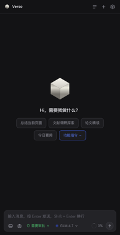
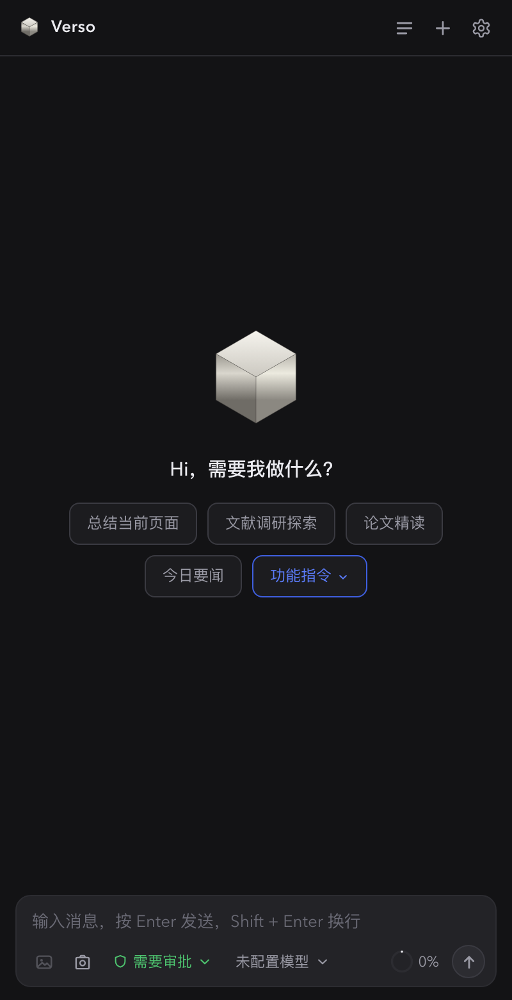
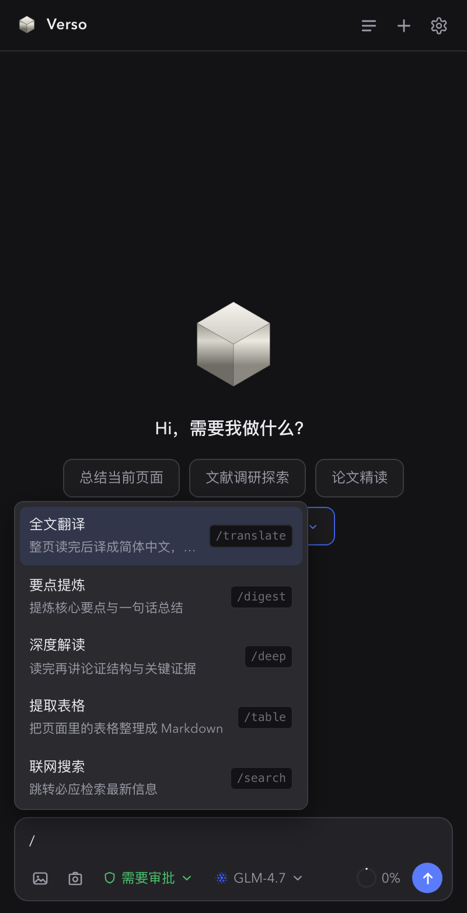
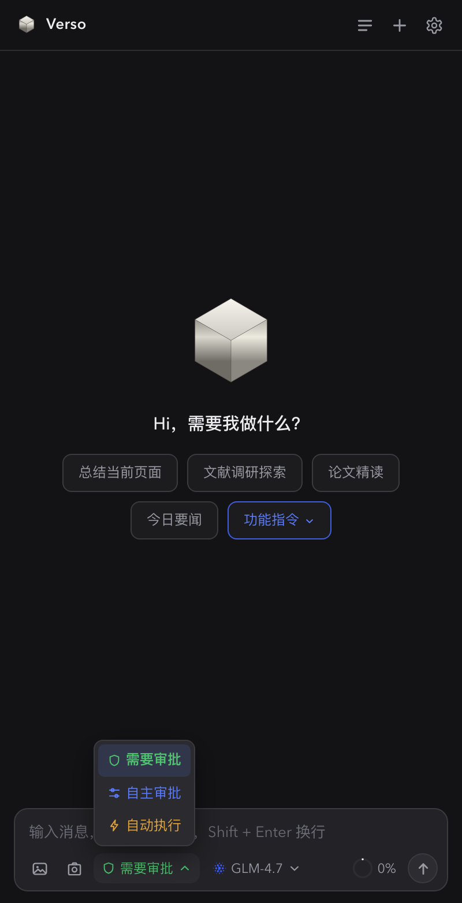
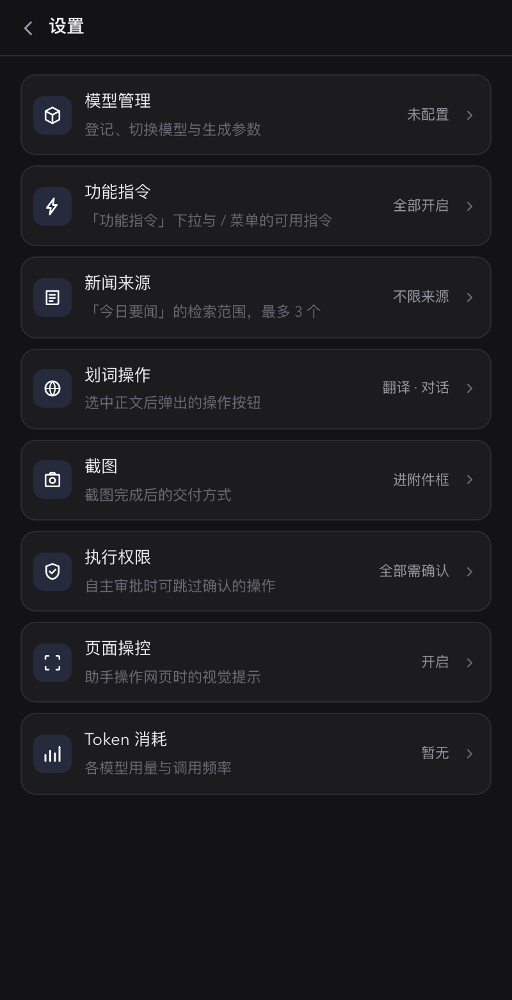
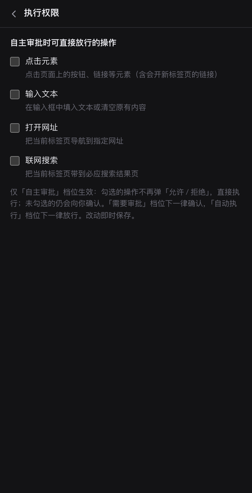

<p align="center">
  
</p>

<p align="center">
  
</p>

一键唤起智能侧边栏，与当前网页对话：即时问答、要点提炼、全文翻译，还能代你完成点击、填写等页面操作。

所有会话与配置只存在本地，模型 API 由你自己登记、直连供应商——没有中间服务器，没有账号体系。

<p align="center">
  
</p>

## 它解决什么问题

| 没有它时 | 有它之后 |
|---|---|
| 读完一篇长文 / 论文 / 外文页面，要复制粘贴到聊天网站反复横跳 | 侧边栏贴着网页打开，`/summary` 一键通读全页后给总结，`/translate` 整页翻译保留结构 |
| 模型知识有截止日期，问最新信息就露怯 | 联网搜索 + 实时读取页面，要闻、价格、版本号都能查 |
| 问答工具只能「看」不能「动」，查完还得自己动手填表单、点按钮 | Agent 能替你点击、输入、打开网址，每一步都有步骤卡片可审计 |
| 只能用单一供应商的闭源客户端 | 自带 OpenAI 兼容多模型管理，DeepSeek / GLM / Kimi / Ollama / OpenAI 随便切 |
| 自动化操作不放心，全手动又太累 | 三级执行权限：从逐条审批到自动执行，粒度你自己定 |

## 功能特性

### 💬 与当前网页对话
- **长文分段读取**：论文、文档一次读上万字，自动分段续读，不用先滚动页面
- **划词引用**：选中正文一键「加入对话」，原文以引用卡随消息发出
- **图片理解**：截图 / 粘贴图片进对话（需模型支持视觉）
- **会话管理**：多会话、按标签页跟随、上下文压缩仪表（超预算自动摘要最旧历史）

### 🤖 页面 Agent
- 可执行动作：读取页面、点击、输入、滚动、打开网址、联网搜索、等待、提取文字
- **步骤卡片**：每一步操作实时展示在对话流里，成功 / 失败 / 已跳过一目了然
- **操控流光**：助手操作网页时页面四边亮起光带，「这个页面正在被操纵」一眼可见（可关）

### 🔐 三级执行权限

| 档位 | 行为 |
|---|---|
| 🟢 需要审批 | 所有会改动页面的操作，逐条弹「允许 / 拒绝」 |
| 🔵 自主审批 | 自选放行清单（设置 → 执行权限）：勾选的操作直接执行，其余仍确认 |
| 🟡 自动执行 | 全部直接执行，不打断 |

只读操作（读页面、滚动、等待、提取文字、文献检索）在任何档位下都不会打断你。

### ⚡ 功能指令
输入 `/` 唤起菜单，或点空状态的「功能指令」下拉；指令以蓝色短名（如 `/polish`）显示在气泡里，长指令原文走隐藏上下文，不刷屏。

| 指令 | 作用 |
|---|---|
| `/summary` | 总结当前页面 |
| `/translate` | 全文翻译成简体中文，保留结构 |
| `/digest` | 提炼 5~8 条核心要点 |
| `/deep` | 深度解读：论证结构与关键证据 |
| `/table` | 把页面表格整理成 Markdown |
| `/search` | 联网搜索（补搜索词后发送） |
| `/polish` | 文案润色（粘贴待润色文本） |
| `/news` | 今日要闻（来源可在设置里限定，最多 3 个站点） |
| `/survey` | 文献调研：arXiv 检索，产出 WHY / HOW / WHAT 调研报告 |
| `/paper` | 论文精读：对当前页论文输出精读卡（定位 / 承重设计 / 证据链 / 边界） |

顶部快捷 chips 一键直发，指令可在设置里按需开关。

### 🔧 多模型管理
- OpenAI 兼容接口通吃：内置 DeepSeek / 智谱 GLM / Kimi / Ollama / OpenAI 预设，也支持自定义
- 生成参数（温度 / top_p / max_tokens）、上下文预算、工具轮次上限均可调
- Token 用量统计：按模型、按用途、近 7 天可视化

## 界面预览

| | |
|---|---|
|  |  |
| 首页：快捷 chips 一键直发 | 对话：思考块 + 步骤卡片 + Markdown 回答 |
|  |  |
| 输入 `/` 唤起功能指令菜单 | 三档执行权限，语义色区分 |
|  |  |
| 设置中心 | 自主审批：自选放行清单 |

## 安装指南

### 1. 加载扩展

1. 下载或克隆本仓库
2. 打开 Chrome，地址栏输入 `chrome://extensions`
3. 右上角打开 **开发者模式**
4. 点左上角 **加载已解压的扩展程序**，选择本项目的 `google-side-assistant` 目录
5. 在工具栏把灵阅AI助手固定（📌），方便随时唤起

> 需要 Chrome / Edge 116+（Manifest V3 侧边栏）。

### 2. 登记模型

首次使用需配置至少一个模型（OpenAI 兼容接口）：

1. 点面板右上角 ⚙️ 进入 **设置 → 模型管理**
2. 填写名称、选择供应商（自动带出 API 地址）、模型标识与 API Key
3. 保存即可，顶部胶囊随时切换模型

| 供应商 | API 地址（自动填充） | 说明 |
|---|---|---|
| DeepSeek | `https://api.deepseek.com/v1` | |
| 智谱 GLM | `https://open.bigmodel.cn/api/paas/v4` | |
| Kimi（月之暗面） | `https://api.moonshot.cn/v1` | |
| Ollama | `http://localhost:11434/v1` | 本地模型，无需 Key |
| OpenAI | `https://api.openai.com/v1` | |
| 自定义 | 任意 | 任何 OpenAI 兼容网关 |

### 3. 开始使用

1. 打开任意网页，点工具栏图标展开侧边栏
2. 点顶部 chip（如「总结当前页面」）或直接提问
3. 让它动手时（点击 / 填写 / 打开网址），按需调整底部权限胶囊的档位

## 本地开发

```bash
# 起 dev 服务（静态文件 + chrome.* shim，面板可直接在标签页里预览）
python3 dev_server.py 8801
# 打开 http://127.0.0.1:8801

# 可选：截图工具链（本仓库文档截图即由它生成）
npm install
```

```text
google-side-assistant/
├── background.js          # Service Worker：CDP 页面操控引擎、动作路由、划词翻译调度
├── manifest.json
├── content/translate.js   # 内容脚本：划词翻译 / 加入对话
├── page/                  # 侧边栏面板（零构建，原生 ES Module）
│   ├── sidepanel.html
│   ├── css/               # base / layout / chat / composer
│   └── js/
│       ├── app.js         # 装配入口
│       ├── chat.js        # 对话流：流式渲染、工具循环、审批、上下文压缩
│       ├── composer.js    # 输入区：指令块、附件、权限 / 模型下拉
│       ├── commands.js    # 功能指令：/ 菜单与「功能指令」下拉
│       ├── skills.js      # 内置 skill：文献调研 / 论文精读 / 今日要闻
│       ├── settings.js    # 设置页
│       ├── store.js       # 数据层（chrome.storage.local）
│       └── actions/       # 工具 DSL 注册表 + 执行通道
├── dev_server.py          # 本地开发服务器
└── docs/screenshots/      # README 截图
```

## 隐私说明

- 会话、配置、API Key 全部存放在 `chrome.storage.local`，不上传任何服务器
- 对话请求由面板直连你登记的模型供应商，本项目不含后端
- `<all_urls>` 权限用于读取 / 操作当前页面；不收集浏览行为数据

## 致谢

文献调研与论文精读的提示词框架，蒸馏自社区的 academic-search、deep-research 等 skill 包（见 `skills/` 目录）。
